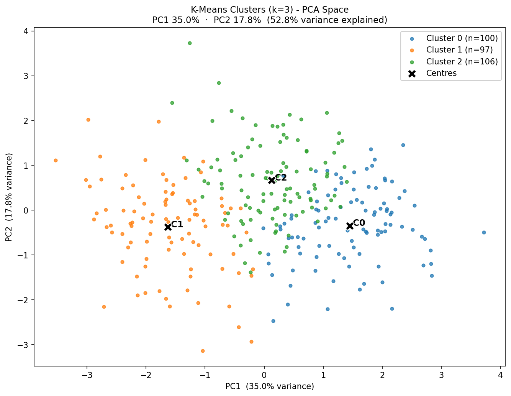
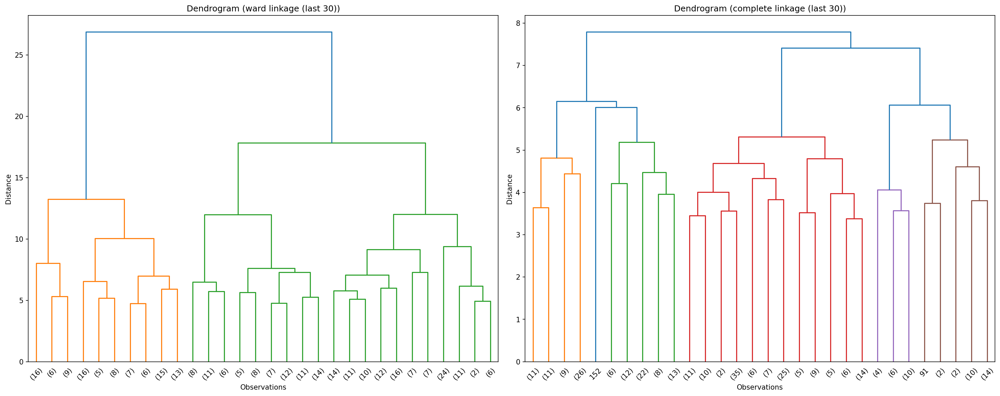

# Clustering Patient Data: K-Means, GMM and Hierarchical Clustering

Comparison of three unsupervised learning methods (K-Means, Gaussian Mixture Models and hierarchical clustering) for finding patient subgroups in the Cleveland Heart Disease dataset, without using the diagnosis, and evaluation of the clusters against the diagnosis afterwards.

Group project for the Machine Learning course of the MSc in Health Data Science (MHEDAS), Universitat Rovira i Virgili.

## Overview

A central problem in health data science is finding patient profiles from clinical measurements alone, before a diagnosis is available. This project clusters the 303 patients of the Cleveland Heart Disease dataset using their clinical and demographic characteristics, with the diagnosis kept hidden. The clusters are then compared with the real diagnosis using the Adjusted Rand Index (ARI) and confusion matrices.

The pipeline covers exploration, handling of missing values and outliers, encoding and scaling, PCA and feature selection, three clustering methods with their model selection criteria, and evaluation.

## Results

The final clustering uses 10 selected features. The number of clusters was chosen for each method with its own criterion, and the clusters were compared with the diagnosis (disease or no disease).

| Method | Clusters | Cluster sizes | ARI |
|--------|----------|---------------|-----|
| Hierarchical (Ward linkage) | 2 | 202 and 101 | 0.2199 |
| K-Means | 3 | 100, 97 and 106 | 0.2041 |
| GMM | 8 | 97, 63, 57, 48, 22, 6, 6 and 4 | 0.1460 |
| Hierarchical (complete linkage) | 2 | 184 and 119 | 0.1217 |

Key findings:

- Ward linkage gave the clearest structure and the highest ARI. One of its two groups, with older patients, higher ST depression and lower maximum heart rate, contains 79% of patients with disease (80 of 101). In the other group the share is 29% (59 of 202).
- K-Means found three well-balanced profiles: a younger low-risk group (18% with disease), an intermediate group (36%) and a high-risk group of older patients with more blocked vessels and mostly asymptomatic chest pain (86%).
- GMM selected 8 components by BIC, but several contain only 4 to 6 patients, so the groups are unstable and hard to interpret.
- All ARI values are low (0.12 to 0.22). The clusters capture real clinical structure, but they do not recover the diagnosis.





_confusion_matrix.png)

## Data

The data is the processed Cleveland subset of the [Heart Disease dataset](https://archive.ics.uci.edu/dataset/45/heart+disease) from the UCI Machine Learning Repository: 303 patients and 13 clinical features, plus a diagnosis from 0 to 4 that is used only for evaluation. The file is included in [`data/`](data/README.md), together with a description of every variable.

## Methods

1. **Cleaning:** missing values (4 in `ca`, 2 in `thal`) filled with the median, and 20 outliers flagged with the IQR method but kept, since they are clinically plausible.
2. **Encoding and scaling:** one-hot encoding of the multi-category variables (`cp`, `restecg`, `slope` and `thal`), a log transformation of the skewed variables (`trestbps`, `chol` and `oldpeak`), standardisation of the numeric variables, and an extra binary indicator for whether ST depression is present.
3. **Feature analysis:** PCA (9 components explain 85% of the variance), used for visualisation, and `SelectKBest` with the F-test on an 80% training split. The two methods agree on `ca`, `oldpeak`, `age`, `chol` and `thalach`, and the final set has 10 features: `ca`, `oldpeak`, `thalach`, `age`, `chol`, `cp` (types 2, 3 and 4) and `thal` (types 3 and 7).
4. **K-Means:** k from 2 to 10, with the elbow method and silhouette score, choosing k = 3 as the balance between compactness and interpretable subgroups (the silhouette peaks at k = 2 with 0.22).
5. **Gaussian Mixture Models:** 2 to 10 components with full covariance matrices and 10 initialisations, choosing the number of components with the lowest BIC (8).
6. **Hierarchical clustering:** Ward and complete linkage, with the dendrograms cut at 2 clusters.
7. **Evaluation:** PCA projections, cluster profiles, ARI against the binary diagnosis and confusion matrices.

The full methodology, results and discussion are in [`docs/clustering_report.pdf`](docs/clustering_report.pdf).

## Repository structure

```
.
├── data/
│   ├── processed.cleveland.data
│   └── README.md
├── docs/
│   └── clustering_report.pdf
├── figures/             
├── notebooks/
│   └── unsupervised_clustering.ipynb
├── README.md
└── requirements.txt
```

## How to run

```bash
git clone https://github.com/cindychenqiu/heart-disease-patient-clustering.git
cd heart-disease-patient-clustering
python -m venv .venv
source .venv\Scripts\activate # on macOS/Linux .venv/bin/activate 
pip install -r requirements.txt
jupyter notebook notebooks/unsupervised_clustering.ipynb
```

Tested with Python 3.12.

## Limitations and next steps

- **Features chosen with the diagnosis:** the feature selection step used the diagnosis labels (`SelectKBest` on the training split), so the selected features are the ones related to disease. This makes the agreement between clusters and diagnosis more favourable than a fully unsupervised selection would give.
- **GMM is over-parameterised for this data:** eight components with full covariance matrices on 303 patients and 10 partly binary features gives very small clusters (4 to 6 patients). Fewer components, diagonal or tied covariances, or a stronger regularisation would be more stable.
- **Hard assignments:** the GMM probabilities were reduced to a single cluster per patient, which loses information on how likely each patient is to belong to each group.
- **Small, single dataset:** 303 patients from one source, so the profiles may not generalise.
- **Only one feature selection method:** other approaches would help check how robust the selected features are.

## Authors and acknowledgements

Group project by Carla Bellido García, Celica Krigul, Keith Megara Osores Vicuña, Ema Stangova and Cindy Chen.  

[LinkedIn](https://www.linkedin.com/in/cindychenqiu/) | [GitHub](https://github.com/cindychenqiu)